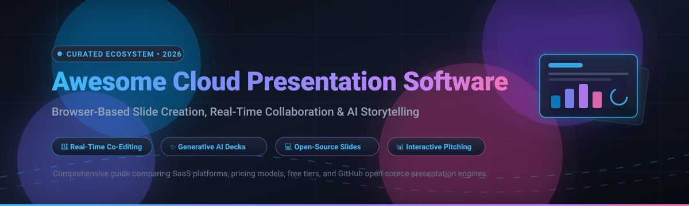

  

# 🚀 Awesome Cloud Presentation Software 📊

  
  
  
  
  
  
  
  

---

## 🌟 Top Cloud Presentation Software Ecosystem

> **The Definitive Curated Directory of Cloud Presentation Platforms, AI Deck Builders & Open-Source Markdown Slide Engines**  
> *Focused on Browser-Based Slide Creation, Real-Time Collaboration & AI-Assisted Presentation Design*  
> **📅 Last updated: March 2026**

This repository tracks the most powerful **cloud-based presentation software**, **hosted SaaS platforms**, and **developer-friendly open-source repositories**. Whether you are an entrepreneur pitching investors, an educator creating interactive lecture materials, a marketing team designing branded collateral, or a developer rendering slides directly from Markdown and Git, this guide compares features, exact pricing tiers, free tier allowances, and open-source star metrics.

Key platform categories include:
- 🏢 **Enterprise Giants & Office Suites**: Google Slides, Microsoft PowerPoint Online, Apple Keynote for iCloud, and Zoho Show.
- 🎨 **Visual Design & Team Pitching**: Canva, Pitch, and Visme.
- 🤖 **Generative AI Slide Creators**: Gamma, Tome, and Beautiful.ai.
- 💻 **Open-Source & Markdown Engines**: reveal.js, Slidev, impress.js, Quarkdown, remark, and Marp.

---

## 📑 Table of Contents

- [📈 Sector Overview & Market Dynamics](#-sector-overview--market-dynamics)
- [☁️ SaaS / Hosted Platforms](#️-saas--hosted-platforms)
- [💻 Open-Source GitHub Projects](#-open-source-github-projects)
- [⭐ Star History](#-star-history)
- [💖 Support & Sponsorship](#-support--sponsorship)
- [🤝 How to Contribute](#-how-to-contribute)
- [⚠️ Disclaimer](#️-disclaimer)

---

## 📈 Sector Overview & Market Dynamics

The global presentation software market is valued between **$7 billion and $8.6 billion**, expanding at a rapid **11.5%–15% CAGR** toward an estimated **$20B–$33B by the early 2030s**. 

The sector exhibits a **moderately fragmented and highly competitive landscape**:
- **Enterprise Core (Oligopoly)**: Legacy productivity heavyweights (Microsoft PowerPoint and Google Slides) retain an entrenched foundation across Fortune 500 corporations and global educational systems.
- **Dynamic Fragmentation & Challengers**: High fragmentation persists across specialized niches. Visual design platforms (**Canva**) command creative teams; modern narrative builders (**Pitch**, **Visme**) capture product startups; and a wave of generative AI-native platforms (**Gamma**, **Tome**, **Beautiful.ai**) have created explosive demand by transforming text documents directly into formatted decks.
- **Developer Movement**: Open-source, Git-driven slide frameworks (**reveal.js**, **Slidev**, **Marp**) have carved out a resilient self-hosted space for engineers, academics, and tech speakers who reject subscription lock-in.

---

## ☁️ SaaS / Hosted Platforms

Below is the comparison of premier browser-based presentation SaaS platforms, sorted in descending order by parent company scale (valuation / market capitalization and annual revenue).

| Product | Scale (Valuation / Revenue) | Description | Pricing (Starting) | Free Tier / Trial Limits |
|:---|:---|:---|:---|:---|
| **[Apple Keynote for iCloud](https://www.icloud.com/)** | 🍎 ~$5.10T Market Cap (Apple) / ~$391B Annual Revenue | Web version of Apple Keynote accessible via iCloud.com from any browser (including Windows). Features smooth animations, collaborative slide editing, and PPTX/PDF export. | **$0 / Free** (Included with standard free Apple ID; no subscription required) | **Free forever plan**: full Keynote web editor via iCloud.com, real-time collaboration, 5 GB shared iCloud storage, export to PPTX/PDF/HTML, present from browser. No credit card required. |
| **[Microsoft PowerPoint Online](https://www.microsoft.com/en-us/microsoft-365/powerpoint)** | 🪟 ~$4.04T Market Cap (Microsoft) / ~$245B Annual Revenue | Web version of PowerPoint with core slide editing, real-time co-authoring, and cloud integration within Microsoft 365. | **$7.00/user/month** (Microsoft 365 Business Basic, annual commitment) | **Free forever plan**: PowerPoint web editor access, 5 GB OneDrive storage, basic templates/fonts/icons, dictation, and real-time collaboration with a free Microsoft account. No time limits. |
| **[Google Slides](https://slides.google.com/)** | 🔍 ~$3.50T Market Cap (Alphabet) / ~$307B Annual Revenue | Browser-based presentation editor within Google Workspace. Real-time collaboration, revision history, and native integration with Google Drive. | **$7.00/user/month** (Google Workspace Business Starter, annual commitment) | **Free forever plan**: complete Google Slides web editor, real-time collaboration, offline editing, 15 GB shared Google Drive storage with a personal Google account. **14-day free trial** for Workspace Business plans. |
| **[Canva](https://www.canva.com/)** | 🎨 ~$32B Valuation / ~$3.5B Annual Revenue | Visual design platform with presentation templates, drag-and-drop slide editor, and Magic Studio AI generation capabilities. | **$15.00/month** ($180 billed annually, or $18/month-to-month for Canva Pro) | **Free forever plan**: access to core presentation editor, 1M+ free templates, 1,000+ fonts, and 5 GB cloud storage. **30-day free trial** for Canva Pro/Teams with full premium asset access. |
| **[Zoho Show](https://www.zoho.com/show/)** | 🏢 ~$15B Implied Valuation / ~$1.5B Annual Revenue (Zoho Corp) | Cloud presentation platform within the Zoho Office Suite. Supports 100+ templates, real-time collaboration, slide broadcast, and WorkDrive integration. | **$2.50/user/month** (Zoho Show Professional / Zoho Workplace Standard, annual commitment) | **Free forever plan (individuals)**: unlimited presentations, unlimited cloud storage, 500 MB file upload limit, real-time collaboration, slide broadcast/embed, and password-protected exports. **15-day free trial** for Professional plan. |
| **[Gamma](https://gamma.app/)** | ⚡ ~$2.1B Valuation / ~$100M+ ARR | AI-native visual medium for presentations, webpages, and docs. Automatically structures decks from prompts or text files with interactive widgets. | **$8.00/user/month** (Plus plan, billed annually at $96/year, or $10 month-to-month) | **Free forever plan**: unlimited deck creation, 400 one-time AI credits at signup, basic PDF/PPTX export (with Gamma badge branding). Paid plans offer a **7-day free trial** with full feature access. |
| **[Prezi](https://prezi.com/)** | 🌀 ~$250M Valuation (Est.) / ~$45M–$50M ARR | Non-linear spatial presentation tool famous for zooming user interface, visual storytelling, and Prezi Video overlay presentations. | **$7.00/month** (Standard plan, billed annually, or $15 month-to-month) | **Free forever plan (Basic)**: up to 5 public presentations, ~100 MB cloud storage, access to basic templates and zooming editor. **14-day free trial** for Plus and Premium tiers. |
| **[Tome](https://tome.app/)** | 📖 ~$300M Valuation / ~$15M ARR | Generative AI presentation and narrative workspace using advanced LLMs to turn prompts, briefs, and documents into interactive slide decks. | **$16.00/user/month** (Standard plan, billed annually at $192/year, or $20 month-to-month) | **Free trial**: 500 one-time AI creation credits upon signup to generate and customize decks. No permanent free tier for ongoing credit refills. |
| **[Beautiful.ai](https://www.beautiful.ai/)** | ✨ ~$250M Valuation (Est.) / ~$15M ARR | AI-powered presentation maker equipped with "Smart Slides" that automatically adapt and reformat layouts as content is added. | **$12.00/month** (Pro plan, billed annually at $144/year, or $45 month-to-month) | **14-day free trial**: full access to Pro features, unlimited Smart Slides, AI generation, and export features (credit card required; cancel anytime before day 14 without charge). No permanent free tier. |
| **[Pitch](https://pitch.com/)** | 🎯 ~$200M Valuation (Est.) / ~$10M+ ARR | Modern collaborative presentation software designed for fast-moving teams, custom pitch decks, real-time slide analytics, and interactive video embeds. | **$13.00/seat/month** (Pitch Plus, billed annually at $156/year, or $15 month-to-month) | **Free forever plan**: up to 5 team workspace members, unlimited presentations, custom template access, and core collaborative slide editing. |
| **[Visme](https://www.visme.co/)** | 📊 ~$150M Valuation (Est.) / ~$20M+ ARR | Comprehensive visual content creation and presentation suite combining slide decks, data widgets, charts, and interactive document elements. | **$12.25/month** (Starter plan, billed annually at $147/year, or $29 month-to-month) | **Free forever plan (Basic)**: 100 MB cloud storage, access to standard templates, unlimited project creation, and regular community support. |

---

## 💻 Open-Source GitHub Projects

Discover top open-source slide frameworks, Markdown presentation compilers, and self-hosted presentation software. Sorted in descending order by GitHub stargazer count.

| Project | Stars_Badge | Description |
|:---|:---:|:---|
| **[reveal.js](https://github.com/hakimel/reveal.js)** |  | The HTML presentation framework. Features 2D nested slide navigation, Markdown support, Auto-Animate transitions, speaker notes view, LaTeX math formulas, code syntax highlighting, and PDF export. The web's most popular open-source slide library. |
| **[Slidev](https://github.com/slidevjs/slidev)** |  | Presentation slides for developers powered by Vite and Vue 3. Write slides in Markdown with embedded Vue components, interactive widgets, live code execution, UnoCSS styling, Mermaid diagrams, and recording/presenter modes. |
| **[impress.js](https://github.com/impress/impress.js)** |  | Presentation framework based on the power of CSS3 transforms and transitions in modern browsers, inspired by the non-linear zooming idea behind Prezi. |
| **[Quarkdown](https://github.com/iamgio/quarkdown)** |  | Extended Markdown processor and presenter with superpowers: creates reactive interactive slide decks, documents, papers, and knowledge bases with live code, charts, and mathematical notation. |
| **[remark](https://github.com/gnab/remark)** |  | Lightweight, in-browser, Markdown-driven slideshow tool targeted at speakers. Runs standalone inside any browser without build tools or server dependencies. |
| **[Marp](https://github.com/marp-team/marp)** |  | The entry point to the Marp Markdown presentation ecosystem. Convert plain Markdown into clean presentation slides with VS Code live-preview integration and CLI export to HTML, PDF, PPTX, and images. |
| **[Spectacle](https://github.com/FormidableLabs/spectacle)** |  | React-based presentation library that allows developers to write decks using JSX syntax, enabling live interactive code demos, custom React components, animations, and presenter console views. |
| **[GitPitch](https://github.com/gitpitch/gitpitch)** |  | Markdown presentation service and engine for tech conferences, training, developer advocates, and educators. Turns Git repositories into slides with code highlighting and math rendering. |
| **[Shower](https://github.com/shower/shower)** |  | Clean, modular HTML/CSS/JS presentation engine with slide list overview, full-screen presentation mode, touch support, and responsive layouts. |
| **[Marp CLI](https://github.com/marp-team/marp-cli)** |  | Official command-line interface for Marp and Marpit slide converters. Converts Markdown decks into PDF, PPTX, HTML, and PNG directly from terminal or CI/CD pipelines. |
| **[DeckTape](https://github.com/astefanutti/decktape)** |  | High-quality PDF exporter for HTML-based presentations. Supports reveal.js, impress.js, remark, Shower, Slidev, and bespoke web slide decks via headless Chromium. |
| **[goslide](https://github.com/GMfatcat/goslide)** |  | Markdown-based presentation tool in Go. Write slides in plain `.md` with frontmatter and `---` breaks; 22 themes, Chart.js charts, Mermaid diagrams, sortable tables, interactive controls, speaker view, and standalone HTML export. Single ~8 MB binary with optional AI generation via OpenAI-compatible endpoints. |

---

## 📈 Star History

---

## 💖 Support & Sponsorship

Thank you so much for visiting this repository! If this curated guide saved you time or helped you pick the right presentation stack:

- ⭐ **Star this repository** to help others discover it.
- 🍴 **Fork it** and build your own custom slide pipeline.
- 📢 **Share it** with fellow presenters, designers, and developers.
- ☕ **Buy me a coffee**: Support ongoing research, maintenance, and open-source contributions directly via the [GitHub Sponsor Dashboard](https://github.com/sponsors/ishandutta2007).

---

## 🤝 How to Contribute

Contributions are welcome! To propose additions or updates:

1. Fork the repository.
2. Edit [`README.md`](file:///C:/Users/ishan/Documents/Projects/Awesome-Cloud-Presentation-Software/README.md) following the existing tabular structure (include starting tier prices, explicit free tier limits, company valuation/scale, or stargazer badge links).
3. Ensure tools are browser-based, cloud-enabled, or open-source presentation software.
4. Submit a Pull Request with a clear, concise summary of the changes.

---

## ⚠️ Disclaimer

- This list is **community-curated** for informational and educational purposes; inclusion does not constitute a formal commercial endorsement.
- Cloud presentation tools process and store business content on remote infrastructure; review security policies and data handling agreements before uploading confidential materials.
- Pricing, plan limits, and AI credit allowances change frequently; please verify current terms directly on vendor pricing pages before subscribing.

---

  <b>Built with care for presenters, designers, educators, and developers worldwide.</b> 
  Let's make cloud presentation software more open, collaborative, and expressive.

